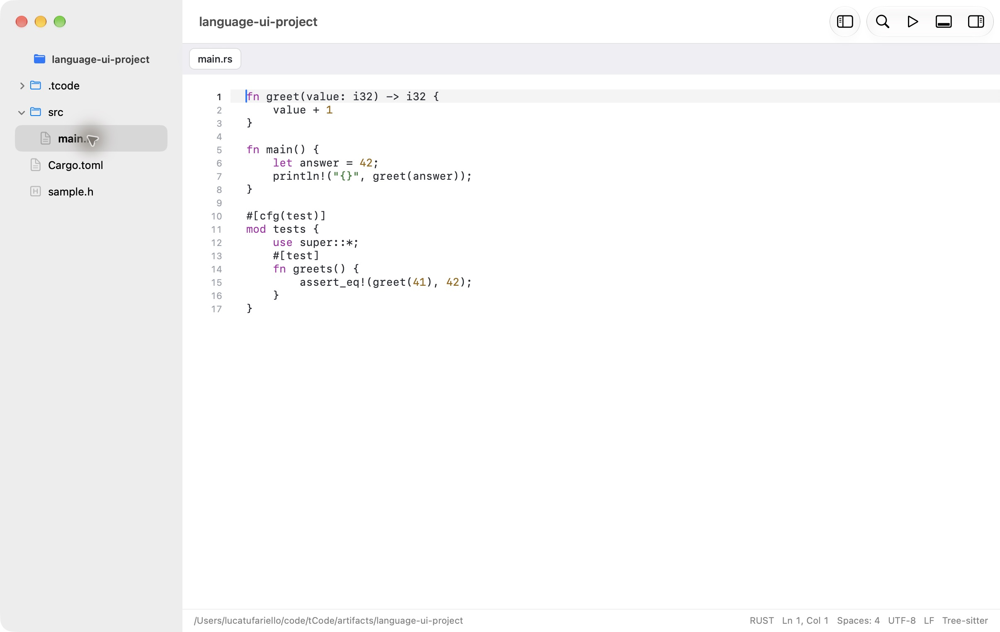

# tCode

tCode 0.2 is a native AppKit/SwiftUI code editor and initial IDE for **macOS 27 on Apple Silicon**. The editor, window system, PTY terminal, LSP client, DAP client, and Git UI run natively. The app has no browser renderer, JavaScript runtime, local server, account, or telemetry.

This is an initial implementation with an extensible language foundation. Python, C/C++, and Swift configurations are bundled. Rust is an optional catalog configuration installed without rebuilding the app. Language support is separate from compilers, interpreters, and SDKs. Read the [feature matrix](docs/STATUS.md) for the current boundaries and [contributing guide](CONTRIBUTING.md) for development and release checks.

**Catalog publication status:** the four starter configurations work locally. Native grammar artifacts and the remote catalog are prepared for review; their GitHub Release URLs are not yet a released online installation service. New grammar downloads become available after publication and end-to-end verification. See [language support](docs/LANGUAGE-SUPPORT.md).

## Build and launch

Requires an Apple Silicon Mac, macOS 27, and Xcode 27 / Swift 6.4 selected by `xcode-select`.

```sh
./scripts/build.sh
open dist/tCode.app
```

The script checks the host and SDK, resolves the pinned SwiftTerm dependency, builds arm64 Release, assembles the app with its sandboxed native syntax XPC helper, includes license notices, and signs locally with an ad hoc signature. The result is `dist/tCode.app`. Developer ID signing and notarization have not been performed. Language tools and optional grammar modules are discovered or installed separately.

## First use

tCode opens on its welcome page, with no file and no folder loaded. Recent folders are listed there for reopening. From there:

1. Choose **File → Open Folder** (⇧⌘O) or **New Project Folder** (⌥⌘N). Opening a folder does not run its tasks or tools. The project name titles the sidebar above its file list.
2. Create nested folders with **File → New Folder** (⌃⌘N) and files with the sidebar context menu or Command Palette (⇧⌘P). New File (⌘N) creates an untitled buffer; Save (⌘S) chooses its location.
3. Use Quick Open (⌘P), Go to Line (⌘L), Find in File (⌘F), and workspace regex search (⇧⌘F). The palette includes a reviewed workspace replacement command.
4. Open **Settings → Language Support** to inspect Installed packs and the Catalog. Configure existing tools, explicitly Validate them, or review an installation plan. **Editor → Document Language…** selects Automatic, Plain Text, or an installed language for ambiguous files and untitled buffers. Choose **Editor → Enable Language Tools** explicitly to connect a server. Missing support leaves editing available.
5. Use Build (⌘B), Run (⌘R), and Test (⌘U) from the Run menu. **Edit Run Configuration** stores executable, arguments, environment, working directory, Python interpreter, and debug program in `.tcode/run.json`. Execution occurs only on your command.
6. Open a real zsh terminal with ⇧⌘` or the panel's + button. The palette switches or closes terminal sessions.

Editor tabs have no close button: close one with ⌘W, or right-click it for Close Tab, Close Other Tabs, Close All Tabs, Reveal in Finder, and Copy Path.

Toggle a breakpoint at the caret with ⇧⌘Y or click the gutter. Choose Start Debugging, then use the Run menu for stepping, call stack, variables, and saved watches. Debugging requires a saved file and an available adapter. Build C++, Swift, and Rust targets with debug symbols before launching LLDB.

Settings (⌘,) provides appearance, editor font/size, indentation, autosave, Language Support, and menu shortcut overrides. New panes adopt editor preferences. Workspace settings and the supported EditorConfig subset are documented in [setup](docs/SETUP.md).

## Optional language tools

The app edits files offline without external tools. **Language Support → Catalog → Install…** shows optional downloads, hashes, prerequisites, destinations, and expected changes before approval. Choose Configuration Only to install recognition/editing metadata without downloading tools. Existing tools are reused after health checks. tCode manages versioned tool environments and native grammar downloads; Python itself, Rust toolchains, Xcode, and CMake remain external prerequisites.

The original explicit setup script is retained for users of the earlier tools environment:

```sh
./scripts/setup-tools.sh /opt/homebrew/bin/python3.12
```

It installs pinned packages under `~/Library/Application Support/tCode/tools` and does not change a project's dependencies. It needs native CPython 3.12 and network access. New managed installs use `ManagedTools` instead and preserve this legacy environment. See [setup](docs/SETUP.md) for Python, C/C++, Swift, and Rust workflows, and [pack authoring](docs/LANGUAGE-SUPPORT.md) for local import/export and workspace overrides.

## Validation

```sh
swift test --arch arm64
TCODE_INTEGRATION=1 swift test --arch arm64
```

The second command exercises real language tools and debugger adapters. Tool setup is required; unavailable tools cause explicit integration skips. Parser and packaged XPC checks, including isolation, are described in [native syntax](docs/SYNTAX.md). For reproducible hardware benchmarks:

```sh
TCODE_INTEGRATION=1 \
TCODE_SEARCH_METRICS="$PWD/artifacts/language-search-metrics.json" \
TCODE_EDITOR_METRICS="$PWD/artifacts/language-editor-metrics.json" \
swift test --arch arm64
```

See [validation and measured performance](docs/VALIDATION.md), [architecture](docs/ARCHITECTURE.md), [feature status](docs/STATUS.md), and [dependency notices](docs/THIRD-PARTY.md). Screenshots in `artifacts/` show the actual native application. The packaged release is `dist/tCode.app`; its verified review archive is `dist/tCode-0.2.0-macOS27-arm64.zip`. Run `python3 scripts/verify-release.py` to prepare and verify that local archive without publishing it.

AI chat, provider APIs, coding agents, and the planned language-setup skill are not part of this release. The language platform remains usable without an AI account.



[Language catalog](artifacts/language-support-catalog.png) · [Rust completion](artifacts/rust-completion.png) · [Rust debugger](artifacts/rust-debugger.png)

Earlier native workflows: [Terminal](artifacts/dark.png) · [Light appearance](artifacts/light.png) · [Python debugger](artifacts/debugger.png) · [C++ debugger](artifacts/cpp-debugger.png) · [Swift debugger](artifacts/swift-debugger.png)
