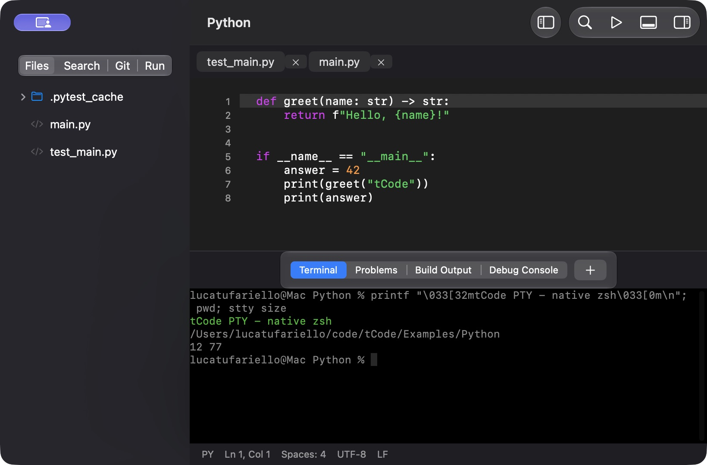

# tCode

tCode 0.1 is a native AppKit/SwiftUI code editor and initial IDE for **macOS 27 on Apple Silicon**. The editor, window system, PTY terminal, LSP client, DAP client, and Git UI run natively. The app has no browser renderer, JavaScript runtime, local server, account, or telemetry.

This is an initial implementation with tested Python, C/C++, and SwiftPM workflows. Read the [feature matrix](docs/STATUS.md) for boundaries before using it on important work.

## Build and launch

Requires an Apple Silicon Mac, macOS 27, and Xcode 27 / Swift 6.4 selected by `xcode-select`.

```sh
./scripts/build.sh
open dist/tCode.app
```

The script checks the host and SDK, resolves the pinned SwiftTerm dependency, builds arm64 Release, assembles the app, includes license notices, and signs locally with an ad hoc signature. The result is `dist/tCode.app`. It is not notarized or App Store packaged. No native helper executables are bundled. External language tools are discovered separately.

## First use

1. Choose **File → Open Folder** (⇧⌘O) or **New Project Folder** (⌥⌘N). Opening a folder does not run its tasks or tools.
2. Create nested folders with **File → New Folder** (⌃⌘N) and files with the sidebar context menu or Command Palette (⇧⌘P). New File (⌘N) creates an untitled buffer; Save (⌘S) chooses its location.
3. Use Quick Open (⌘P), Go to Line (⌘L), Find (⌘F), and workspace regex search (⇧⌘F). The palette includes a reviewed workspace replacement command.
4. Choose **Editor → Enable Language Tools** explicitly for completion, diagnostics, definitions, hover, signatures, references, symbols, rename, and code actions. Missing tools leave editing available.
5. Use Build (⌘B), Run (⌘R), Test (⌘U), and the Run sidebar. **Edit Run Configuration** stores executable, arguments, environment, working directory, Python interpreter, and debug program in `.tcode/run.json`. Execution occurs only on your command.
6. Open a real zsh terminal with ⇧⌘` or the panel's + button. The palette switches or closes terminal sessions.

Toggle a breakpoint at the caret with ⇧⌘Y or click the gutter. Choose Start Debugging, then use the Run sidebar for stepping, stack frames, variables, and saved watches. Debugging requires a saved file and an available adapter. Build C++ and Swift targets with debug symbols before launching LLDB.

Settings (⌘,) provides appearance, editor font/size, indentation, autosave, language-tool enablement/paths, and menu shortcut overrides. New panes adopt editor preferences. Workspace settings and the supported EditorConfig subset are documented in [setup](docs/SETUP.md).

## Optional language tools

The app can edit files without installing these. To reproduce the tested Python tools and clang-format in an isolated user tools environment:

```sh
./scripts/setup-tools.sh /opt/homebrew/bin/python3.12
```

This explicitly installs pinned packages under `~/Library/Application Support/tCode/tools`; it does not change a project's dependencies. The setup script needs an existing native Python 3.12 and network access. Xcode supplies SourceKit-LSP, LLDB DAP, Swift, and swift-format. CMake is an external prerequisite for C/C++ projects. See [setup and examples](docs/SETUP.md) for exact workflows and tool versions.

## Validation

```sh
swift test --arch arm64
TCODE_INTEGRATION=1 swift test --arch arm64
```

The second command exercises actual pylsp/Ruff, clangd, SourceKit-LSP, debugpy, and C++/Swift LLDB DAP, not protocol mocks. Tool setup is required; unavailable tools cause explicit integration skips. For reproducible hardware benchmarks:

```sh
TCODE_INTEGRATION=1 \
TCODE_SEARCH_METRICS="$PWD/artifacts/search-metrics.json" \
TCODE_EDITOR_METRICS="$PWD/artifacts/editor-metrics.json" \
swift test --arch arm64
```

See [validation and measured performance](docs/VALIDATION.md), [architecture](docs/ARCHITECTURE.md), [feature status](docs/STATUS.md), and [dependency notices](docs/THIRD-PARTY.md). Screenshots in `artifacts/` show the actual native application. The packaged release is `dist/tCode.app`; its verified archive is `dist/tCode-0.1.0-macOS27-arm64.zip`.



[Light appearance](artifacts/light.png) · [Python debugger](artifacts/debugger.png) · [C++ debugger](artifacts/cpp-debugger.png) · [Swift debugger](artifacts/swift-debugger.png)
