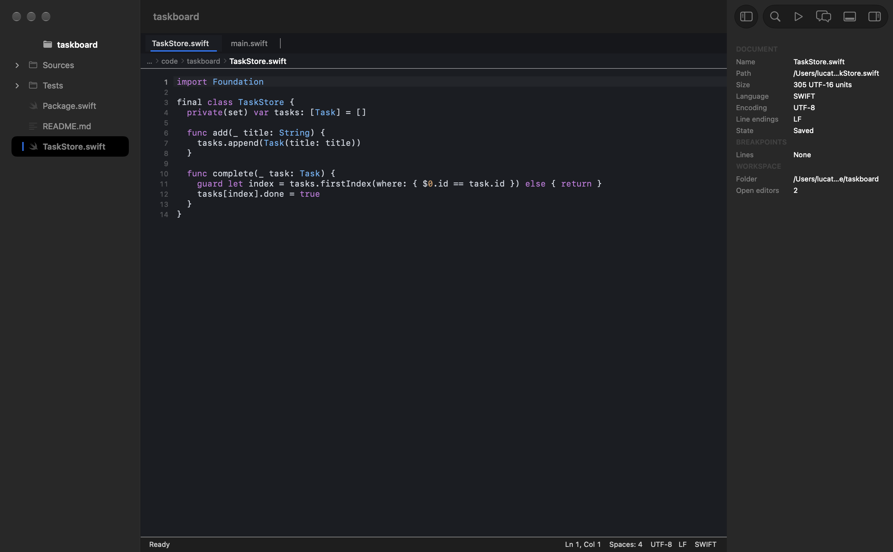
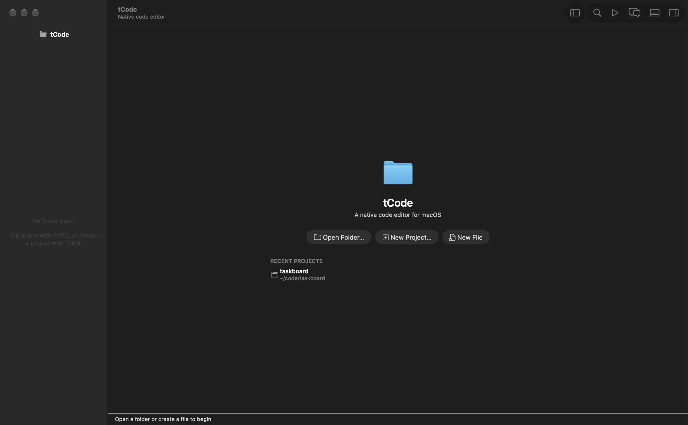
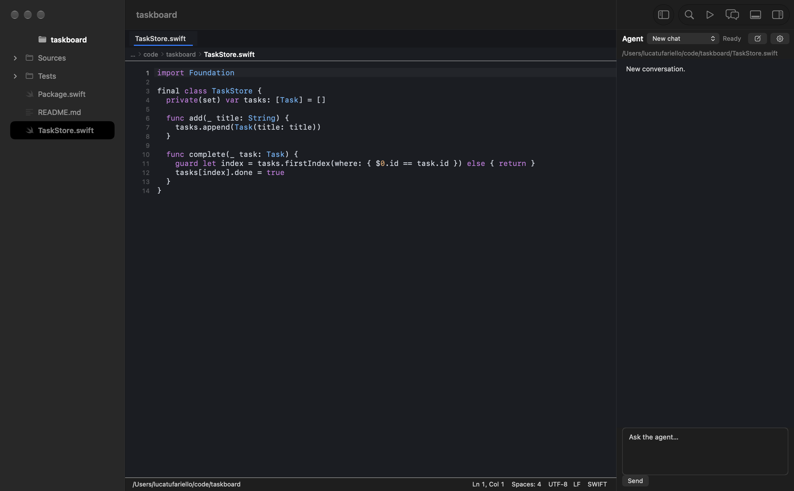
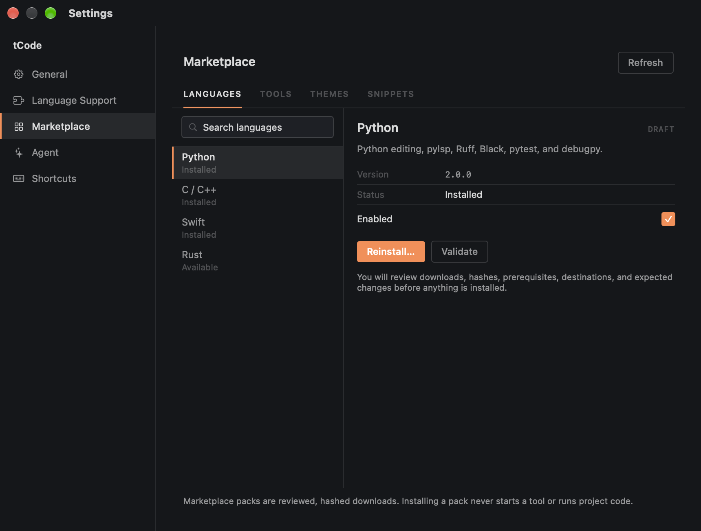
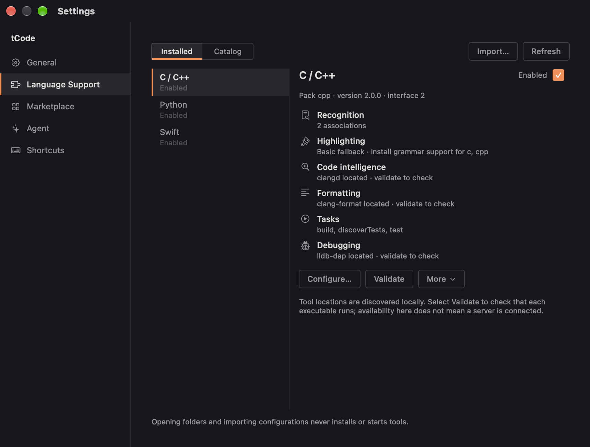
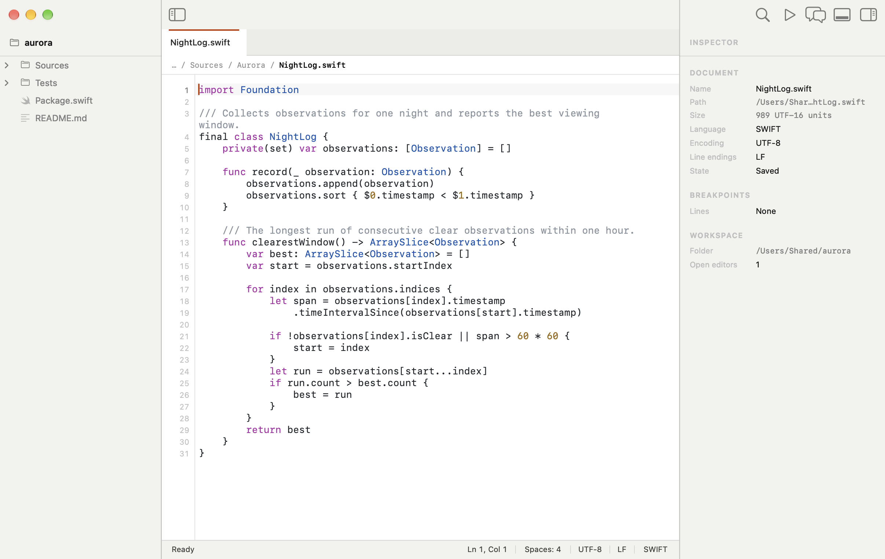

# tCode

tCode is a native macOS IDE for **Apple Silicon**: AppKit and SwiftUI chrome, a real `NSTextView`/TextKit editor, a PTY terminal, LSP and DAP clients, Git, an optional AI agent, and an in-app marketplace. There is no browser renderer, JavaScript runtime, local server, account, or telemetry.



## What it is

tCode is built around a simple constraint: the editor should feel like a native macOS instrument, not a web app in a window.

- **Native editing.** `NSTextView` with TextKit 1, shared text storage and undo across split panes, native IME, find/replace, accessibility, and a custom line-number/breakpoint gutter.
- **Native chrome.** Unified toolbar, source-list sidebar, flat tabs, breadcrumb, status segments, bottom panel, and inspector. Chrome uses system colors and materials so light, dark, and high-contrast appearances behave correctly.
- **Native tools.** LSP, DAP, formatters, build/test tasks, a real zsh terminal, and Git run as local processes. The app does not ship a JavaScript extension host.
- **Offline by default.** Editing, search, Git, and language configuration work without an account. External tools and the optional AI agent are explicitly enabled.
- **A small, declarative extension model.** Language, tool, theme, and snippet packs are data. The marketplace installs reviewed language/tool packs and imports theme/snippet JSON; it does not execute arbitrary plugin code.

## What is in this build

### Editor

- Native tabs with dirty dots, hover close, an accent underline on the active tab, and preserved caret/scroll/folds/cursors across tab switches.
- Breadcrumb path line, line numbers, current-line tint, bracket matching, syntax highlighting, diagnostics, multiple cursors, folding, comment toggle, duplicate line, and configurable indentation/wrapping.
- Quick Open (⌘P), Go to Line (⌘L), Find in File (⌘F), workspace regex search (⇧⌘F), reviewed workspace replacement, Command Palette (⇧⌘P), and document symbols.
- Split panes share text and undo; editor view state is restored per document.
- Atomic saves with original-byte checks, crash recovery, external-conflict handling, and a real unsaved-changes prompt on close/quit.

### Workspace

- Source-list file tree with active-file selection and an accent marker, native file icons, lazy folders, filters, drag-to-move, rename, duplicate, Trash, reveal, and copy path.
- Structured **Problems** table with severity icons, filtering, counts, and double-click navigation.
- Inspector sections for document facts, breakpoints, and workspace context.
- Status segments for cursor position, indentation, encoding, line endings, language, and tool state. Language and indentation are clickable.

### Language support

- Python, C/C++, Swift, and on-demand Rust configurations.
- Real `pylsp` + Ruff, `clangd`, SourceKit-LSP, and `rust-analyzer`; debugpy, C++/Swift LLDB, and Rust LLDB DAP.
- CMake, SwiftPM, Cargo, pytest, CTest, and Swift test discovery with result navigation.
- Native Tree-sitter grammars in a separately sandboxed XPC worker, with incremental trees and UTF-16 capture conversion.
- Language packs are versioned JSON data with recognition, editor defaults, LSP/formatter/task/debug configuration, and installer recipe references.

### AI agent

- Optional right-side Agent panel, collapsed by default. It runs only when you send a message.
- OpenAI-compatible endpoint, model, system prompt, and streaming responses. The API key is stored in the macOS Keychain.
- Multiple conversations, context from the active file and selection, stop control, and read/list/search tools.
- File writes and shell commands require an explicit approval alert. Paths are workspace-scoped and symlink-safe; writes use the existing atomic conflict check.
- No bundled provider account, telemetry, background polling, or remote coding service.

### Marketplace

- **Languages** and **Tools** install through the reviewed catalog, hashes, prerequisites, and activation checks.
- **Themes** are declarative JSON packs with editor colors. Bundled themes include tCode Dark, tCode Light, Midnight, and Paper; import/apply/remove from the Marketplace.
- **Snippets** are declarative JSON packs merged into **Editor → Insert Snippet** for their language.
- No VSIX execution, marketplace account, or arbitrary third-party code host.

### Terminal and Git

- Real zsh PTY sessions with ANSI color, resize, selection/copy/paste, and multiple switchable sessions.
- Git branch/status, diff, stage/unstage, commit, history, and clean-branch switching. Unmerged files block commits; dirty workspaces block branch switches.

## Build and launch

Requires an Apple Silicon Mac, macOS 27, and Xcode 27 / Swift 6.4 selected by `xcode-select`.

```sh
./scripts/build.sh
open dist/tCode.app
```

The script checks the host and SDK, resolves the pinned SwiftTerm dependency, builds arm64 Release, assembles the app with its sandboxed syntax XPC helper, includes license notices, and signs locally with an ad hoc signature. Developer ID signing and notarization are not performed.

## First use

1. Choose **File → Open Folder** (⇧⌘O) or **New Project Folder** (⌥⌘N). Opening a folder does not run its tasks or tools.
2. Create files with **File → New File** (⌘N) or the sidebar context menu. Save with ⌘S.
3. Use Quick Open (⌘P), Go to Line (⌘L), Find in File (⌘F), and workspace search (⇧⌘F).
4. Open **Settings → Language Support** for installed packs and the catalog, or **Settings → Marketplace** for language, tool, theme, and snippet packs.
5. Open the **Agent** panel from the toolbar or **View/Agent → Toggle Agent** (⌥⌘A). Configure an OpenAI-compatible endpoint, model, and API key in **Settings → Agent**.
6. Use Build (⌘B), Run (⌘R), and Test (⌘U). **Edit Run Configuration** stores the executable, arguments, environment, working directory, interpreter, and debug target in `.tcode/run.json`.
7. Open a zsh terminal with ⇧⌘` or the panel's + button.
8. Toggle a breakpoint with ⇧⌘Y or by clicking the gutter, then start debugging from the Run menu.

## Privacy

Editing works offline. tCode has no account, telemetry, or source upload. Language tools run locally when you enable them in a workspace. The optional AI agent sends only the conversation you submit to the provider you configure; it never polls or runs in the background. Marketplace packs are declarative data and do not execute code.

## Validation

```sh
swift test --arch arm64
TCODE_INTEGRATION=1 swift test --arch arm64
```

The second command exercises real language tools and debugger adapters. Unavailable tools cause explicit integration skips. See [validation and measured performance](docs/VALIDATION.md), [architecture](docs/ARCHITECTURE.md), and [feature status](docs/STATUS.md).

## Screenshots











## Documentation

- [Feature/status matrix](docs/STATUS.md)
- [Architecture](docs/ARCHITECTURE.md)
- [Language support](docs/LANGUAGE-SUPPORT.md)
- [Native syntax](docs/SYNTAX.md)
- [Setup](docs/SETUP.md)
- [Validation](docs/VALIDATION.md)
- [Contributing](CONTRIBUTING.md)
- [Third-party notices](docs/THIRD-PARTY.md)

This is an initial implementation with an extensible language foundation. See the feature matrix for current boundaries. The packaged release is `dist/tCode.app`; signing is ad hoc, and Developer ID/notarization remain a distribution step.
